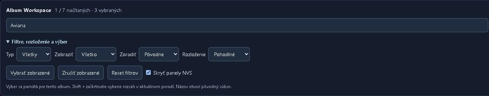
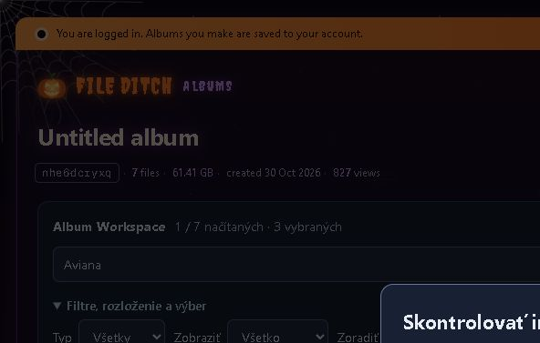

# Fileditch Album Workspace 1.0.0

Samostatný userscript: [fileditch-album-workspace.user.js](../../fileditch-album-workspace.user.js).

## Inštalácia

V Tampermonkey alebo Violentmonkey vytvor nový skript, nahraď celý jeho obsah obsahom `.user.js`, ulož a obnov Fileditch album. Skript sa aktivuje na albumových URL `https://fileditchalbums.st/<10-znakový-kód>`. Neaktivuje sa na účte ani domovskej stránke. Nevyžaduje Nexus pre prehliadanie, výber, prezreté, kopírovanie ani export.

## Návrh a ovládanie

- Zachováva pôvodné karty, odkazy, canvas náhľady a ich poslucháče. Názvy sú celé a zalamujú sa.
- Rozloženia Pohodlné, Kompaktné a Zoznam; filtre typu a stavu; názov, veľkosť a dátum na zoradenie.
- Doplnkové ovládanie je v rozbaľovacej sekcii. Pri prvom načítaní úzkeho okna je zbalené.
- Vyhľadávanie a počty sa týkajú iba kariet načítaných na stránke. Skript neprechádza ďalšie stránky a nehľadá v celom účte.
- Výber aj explicitné označenie Prezreté sa uchovávajú lokálne podľa URL albumu. Prezreté znamená používateľom skontrolované, nie automaticky prehraté ani Nexus watched.
- Shift + checkbox vyberie alebo zruší rozsah v aktuálne filtrovanom a zoradenom poradí. Filtrovanie samo výber nemení.
- Spodné akcie pracujú so všetkými vybranými položkami vrátane tých mimo filtra. Počet mimo filtra je vždy uvedený. „Zrušiť zobrazené“ a „Zrušiť celý výber“ majú odlišný dosah.
- Prepínač Skryť panely NVS iba schová ich rozhranie na tejto stránke. Rozšírenie ďalej beží a panely sa dajú opäť zobraziť. Tento skript nesynchronizuje svoj výber s NVS.
- Kopírovanie URL obsahuje aj query parametre odkazov; stabilná identita výberu query ignoruje. JSON export obsahuje URL albumu a údaje vybraných súborov.

## Nexus import

Importovací dialóg pred odoslaním zmrazí aktuálny výber videí. Ukáže ich presný zoznam, počet mimo filtra, vynechané nevideo súbory, port a editovateľný názov batchu. Používa existujúci `POST /api/v1/intake/import`, iba na localhost portoch 8000–8003, cez GM request. Nepoužíva cookies ani prihlasovacie údaje Fileditch.

Pri úspechu vyžaduje ID import jobu a zobrazí ho. Vytvorený job neznamená dokončené spracovanie všetkých videí. Po timeoute treba pred opakovaním skontrolovať Import Desk. Skript automaticky neopakuje import, nemaže výber, nevytvára Source Board a nemeria kvalitu z názvu súboru. Neznáma dĺžka a rozlíšenie sa neposielajú ako overené údaje.

## Overenie 2026-11-07

Na používateľom dodanom albume bolo cez dočasné vloženie kódu v testovacom prehliadači overené:

- rozpoznanie siedmich videí;
- Shift rozsah od prvého po tretie video → tri vybrané;
- zmena filtra → zachovaný výber a správny počet mimo filtra;
- explicitné prezreté, filter prezretých/neprezretých a obnovenie stránky so zachovaným stavom;
- kopírovanie troch URL (počet overený v schránke);
- JSON export (prehliadač vytvoril `fileditch-nhe6dcryxq.json` v Downloads);
- prázdny výsledok a Reset filtrov;
- prepnutie rozloženia a obnovenie NVS panelov;
- desktop 1440 × 1000 a úzke okno 390 × 844, zbalenie doplnkového ovládania;
- importovací dialóg so zoznamom troch videí mimo filtra;
- zrozumiteľná chyba pri chýbajúcom GM oprávnení.

Reálne odoslanie do Nexus a inštalácia cez Tampermonkey/Violentmonkey **neboli overené**. Testovací prehliadač neposkytuje GM API. V Chrome používateľa nebol skript nainštalovaný. V otvorenom náhľade je zmena len dočasná do obnovenia stránky. Skúšobné výbery a označenia prezretých boli vyčistené.

Automatické testy: `node --test tests/fileditch_workspace.test.cjs` (5 úspešných). Kontrola syntaxe: `node --check fileditch-album-workspace.user.js`. Testy pokrývajú povolené hosty, query tokeny, jednotky veľkosti, nemennosť výberu a kombinovanie filtrov.

